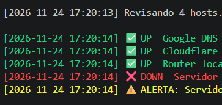

# 🌐 Network Monitor

Script Python que monitorea disponibilidad de hosts en la red en tiempo real,
registrando el estado en un archivo de log con timestamps.

## 🛠️ Tecnologías
- Python 3.x
- Módulos estándar: `subprocess`, `datetime`, `time`, `platform`
- Compatible con Windows y Linux

## ⚙️ Funcionalidades
- Ping automático a múltiples hosts cada X segundos
- Estado en consola con colores: ✅ UP / ❌ DOWN
- Alerta visual en amarillo cuando un host no responde
- Log automático en `monitor_red.log` con timestamp de cada evento
- Configurable: lista de hosts e intervalo de revisión

## 🚀 Uso

```bash
python monitor_red.py
```

## 📄 Ejemplo de salida en consola

```
==================================================
   Monitor de Red — Bryan Carreño
   Revisando cada 10 segundos
   Log: monitor_red.log
   Ctrl+C para detener
==================================================

[2026-11-20 18:00:01] Revisando 4 hosts...
--------------------------------------------------
[2026-11-20 18:00:01] ✅ UP   Google DNS (8.8.8.8)
[2026-11-20 18:00:02] ✅ UP   Cloudflare DNS (1.1.1.1)
[2026-11-20 18:00:03] ❌ DOWN Router local (192.168.1.1)
⚠️  ALERTA: Router local (192.168.1.1) no responde
--------------------------------------------------

## 🔧 Configuración

Edita estas variables al inicio del script:

```python
HOSTS = [
    {"nombre": "Google DNS", "ip": "8.8.8.8"},
    # agrega los hosts que necesites
]
INTERVALO_SEGUNDOS = 10  # cada cuánto revisa
LOG_FILE = "monitor_red.log"
```


## 👤 Autor
Bryan Carreño Hidalgo — Egresado Ingeniería en Informática, INACAP La Granja
